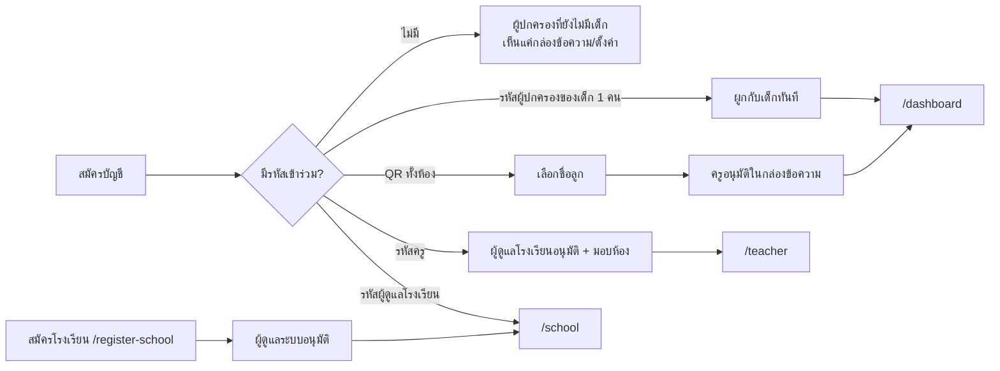
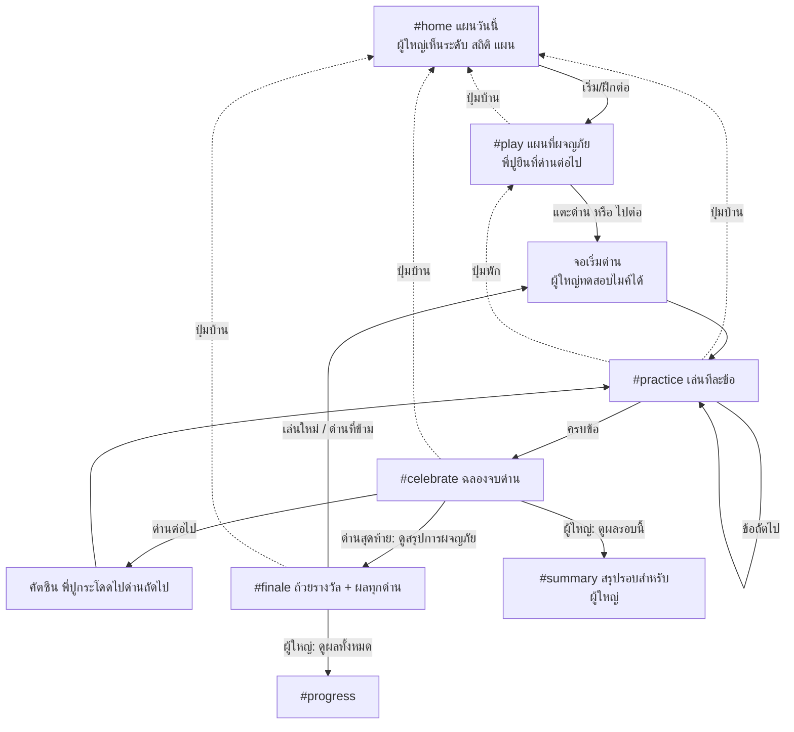
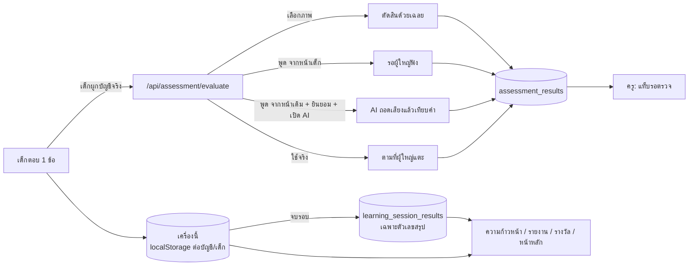

# ภาพรวมระบบเรียน Speech Adventure (สาขา `sky`, 23 พ.ย. 2569)

เอกสารนี้สรุปว่าระบบตอนนี้มีอะไรบ้าง ใครใช้ทำอะไร ข้อมูลไหลไปไหน และจุดที่ยังไม่ต่อกัน
อ้างอิงจากโค้ดจริง (ไฟล์อยู่ใต้ `src/`) ไม่ได้ทดสอบทุกเส้นทางด้วยมือ

---

## 1. ภาพรวมในย่อหน้าเดียว

แอปฝึกพูดสำหรับเด็กไทย 3–12 ปี มี **ห้องฝึก** (`/training`) เป็นหัวใจ เด็กเล่นเกมทีละด่านกับพี่ปู
ผลแต่ละข้อถูกบันทึกในเครื่องก่อน แล้วส่งขึ้นศูนย์ (Supabase) เมื่อเป็นเด็กที่ผูกกับบัญชีจริง
ผู้ปกครองดูผลที่หน้า ความก้าวหน้า / รายงาน / รางวัล · ครูดูห้องเรียนและ "รอตรวจ" · ผู้ดูแลโรงเรียนตั้งเกณฑ์
· ผู้ดูแลระบบอนุมัติโรงเรียนและเปิด/ปิด AI

---

## 2. ผู้ใช้และสิ่งที่แต่ละคนเห็น

| บทบาท | เข้าระบบแล้วไปที่ | เมนูหลัก | ทำอะไรได้ |
|---|---|---|---|
| ผู้เยี่ยมชม (ไม่ล็อกอิน) | `/onboarding` → `/dashboard` | เหมือนผู้ปกครอง | สร้างเด็กในเครื่องได้ ฝึกได้ ผลอยู่ในเครื่องเท่านั้น |
| ผู้ปกครอง | `/dashboard` | หน้าหลัก, ฝึกและเรียน, ความก้าวหน้า, รางวัล, รายงาน, ข้อมูลลูก, กล่องข้อความ, ตั้งค่า | ฝึกกับลูก ดูผล พิมพ์รายงาน ยืนยันผล (ถ้าโรงเรียนอนุญาต) |
| ครู | `/teacher` | ห้องเรียน, รายงาน | ดูนักเรียน พิมพ์ใบเชิญ ตรวจข้อ "รอผู้ใหญ่ฟัง" · **เปิดห้องฝึกไม่ได้** |
| ผู้ดูแลโรงเรียน | `/school` | โรงเรียน, รายงาน | ตั้งห้อง ครู ปีการศึกษา เลื่อนชั้น เกณฑ์ประเมิน เปิด AI ของโรงเรียน |
| ผู้ดูแลระบบ | `/platform` | โรงเรียน, การใช้งาน, เกณฑ์กลาง | อนุมัติโรงเรียน สร้างโรงเรียน ตั้งนโยบาย AI กลาง |

ทุกคนสมัครเป็น "ผู้ปกครอง" ก่อน แล้วเปลี่ยนบทบาทด้วย **รหัสเข้าร่วม** (`/join`) เท่านั้น

---

## 3. โฟลการเรียน (ห้องฝึก `/training`)

### 3.1 จากเข้าห้องฝึกจนจบการผจญภัย (หน้าเด็กแบบใหม่ ค่าเริ่มต้น)

### 3.2 เกมของแต่ละข้อ (เลือกจากรูปแบบข้อ ครอบคลุมครบ 432 กิจกรรม)

| ชนิดข้อ | เกม | เด็กทำอะไร | ใครให้ผล |
|---|---|---|---|
| เลือกภาพ/ตัวอักษร | ส่งของให้พี่ปู | ฟังแล้วแตะภาพ ภาพบินไปตะกร้า | ระบบ (เทียบเฉลย) |
| พูดตามรูปปาก | กระจกวิเศษ | ดูปากพี่ปู กดค้างแล้วพูด | ผู้ใหญ่ (เล่นด้วยกัน) / รอผู้ใหญ่ฟัง (เล่นเอง) |
| พยางค์ / ผสมเสียง | กระโดดหิน (4 ฉาก) | ได้ยินเสียง 1 ช่วง = กระโดด 1 ก้าว | เหมือนข้างบน |
| คำ | การ์ดสติกเกอร์ | ดูภาพแล้วบอกชื่อ | เหมือนข้างบน |
| วลี / ประโยค | รถไฟคำ | ได้ยินเสียง 1 ช่วง = ต่อ 1 ตู้ | เหมือนข้างบน |
| ใช้จริงในชีวิต | เล่นกับผู้ใหญ่ | เล่นนอกจอ | ผู้ใหญ่แตะผล |

- **เล่นด้วยกัน / เล่นเอง:** ระดับ 1–2 เล่นด้วยกัน (ผู้ใหญ่กด ทำได้ / ฝึกอีก / ข้าม) ระดับ 3–4 เล่นเอง ผู้ใหญ่สลับได้
- **ไมค์ใช้ไม่ได้:** เปลี่ยนเป็นแตะจอ ("หนูพูดแล้ว") ข้อนั้นบันทึกเป็นการทดลอง ไม่ส่งศูนย์
- **หน้าฝึกแบบเดิม** ยังอยู่ (เมนูผู้ใหญ่ → ใช้หน้าฝึกแบบเดิม) และบันทึกผลแบบเดียวกันทุกช่อง

### 3.3 หลักสูตร

- **เสียงที่รองรับ:** ป ก ม · **ระดับ:** เริ่มต้น (3–4 ปี), นักสำรวจ (4–6), นักสร้าง (ป.1–3), นักเล่าเรื่อง (ป.4–6) เลือกจากอายุอัตโนมัติ
- 3 แนวการฝึก × 3 เสียง × 4 ระดับ = **432 กิจกรรม**

| แนวการฝึก | ด่าน (ด่านละ 3 ข้อ) |
|---|---|
| ฝึกพูดชัด (speech) | ฟังแยกเสียง → ดูปากพูดตาม → พยางค์ → คำ → วลี/ประโยค → ใช้จริง |
| สื่อสาร (communication) | เข้าใจคำ → ขอสิ่งที่ต้องการ → เล่าเรื่อง |
| โฟนิกส์ (phonics, อนุบาล) | เสียงกับตัวอักษร → ผสมเสียง → อ่าน |

---

## 4. ข้อมูลไหลไปไหน

- **เสียงเด็กไม่ถูกเก็บถาวร** อยู่ในหน่วยความจำระหว่างเล่น ส่งให้ AI เฉพาะหน้าเดิมเมื่อผู้ใหญ่ติ๊กยินยอม
- **AI ปิดเป็นค่าเริ่มต้น** ผู้ดูแลระบบเปิดนโยบายกลาง แล้วโรงเรียนเปิดของตัวเองได้ภายในกรอบนั้น
- **สรุปรอบด้วย AI** (คำแนะนำ + กิจกรรมที่บ้าน 2 อย่าง) แสดงในหน้าสรุปรอบของผู้ใหญ่ เมื่อเปิดนโยบาย

---

## 5. หลังฝึก ผู้ใหญ่ดูอะไรได้

| หน้า | ใคร | เนื้อหา |
|---|---|---|
| `/dashboard` | ผู้ปกครอง | วงสัปดาห์นี้ รอบล่าสุด ภาพรวม 8 สัปดาห์ ปุ่มเริ่มฝึก |
| `/progress` | ผู้ปกครอง, ครู (`?child=`) | ภาพรวม, ประวัติ, บันทึกผู้ใหญ่ |
| `/report` | ผู้ปกครอง, ครู | เลือกช่วงวัน พิมพ์/PDF (ต้องมีสิทธิ์ส่งออก) |
| `/rewards` | ผู้ปกครอง | 13 เหรียญความพยายาม (ไม่ใช่คะแนนความถูก) |
| `/teacher/classrooms/[id]` | ครู | นักเรียน, รอตรวจ (แตะผลทีละข้อ), ใบเชิญ |
| `/school/assessment` | ผู้ดูแลโรงเรียน | เกณฑ์, เปิด AI, ใครยืนยันผลได้ |

---

## 6. จุดที่ยังไม่ต่อกัน (เรียงตามผลกระทบ)

1. **ผู้ปกครองที่ล็อกอินแล้วเพิ่มลูกเองไม่ได้** ต้องมีรหัสจากโรงเรียนหรือผู้ปกครองคนอื่น ส่วนผู้เยี่ยมชมเพิ่มได้แต่ผลอยู่ในเครื่องอย่างเดียว ครอบครัวที่ไม่มีโรงเรียนจึงใช้แบบมีบัญชีไม่ได้
2. **เสียงที่เลือกตอนเริ่มกับเสียงที่ฝึกได้ไม่ตรงกัน** หน้าเริ่มต้นให้เลือก ก ค ต ช แต่ห้องฝึกมีแค่ ป ก ม เสียงอื่นตกไปเป็น ป
3. **ข้อพูดจากหน้าเด็กไปกองที่ "รอผู้ใหญ่ฟัง" ทั้งหมด** หน้าเด็กไม่ส่งเสียงให้ AI และครูก็ฟังเสียงไม่ได้ (ไม่มีการเก็บเสียง) ครูจึงตัดสินจากชื่อคำอย่างเดียว ควรตัดสินใจว่า: ให้ผู้ใหญ่ข้างเด็กเป็นคนให้ผลหลัก, หรือเปิด AI ในหน้าเด็ก (พร้อมขอความยินยอม), หรือเก็บเสียงชั่วคราวให้ครูฟัง
4. **ระบบดาว/ความก้าวหน้าเก่ายังทำงานคู่กัน** ดาวในแถบข้าง ตัวเลือกเด็ก และการ์ดของครูบางส่วนยังอ่านจากระบบเก่า ตัวเลขจึงอาจไม่ตรงกับห้องฝึก
5. **ชื่อเล่น/อายุในหน้าจัดชุดฝึกแยกจากข้อมูลลูก** แก้ที่หนึ่งไม่ไปอีกที่
6. **สิทธิ์ครูขัดกันเอง** สิทธิ์เริ่มต้นของครูมี "เริ่มฝึกได้" แต่ห้องฝึกกันครูไว้ทั้งหมด · หน้ารายงานของครูถ้าไม่ได้เลือกเด็กจะเห็นหน้าว่างของผู้ปกครอง
7. **ผู้ปกครองยืนยันผลอาจถูกปฏิเสธ** เมื่อโรงเรียนตั้งให้เฉพาะครูยืนยัน (อ่านจากโค้ด ยังไม่ได้ลอง)
8. **ของเก่าที่ไม่มีใครเรียก:** `/api/speech/evaluate`, `/api/audio/sample`, หน้า `wireframes`, ข้อความ "Learning prototype" ท้ายห้องฝึก, ข้อมูลตัวอย่างในแท็บการใช้งานของผู้ดูแลระบบ

## 7. ข้อเสนอลำดับถัดไป

1. ตัดสินเรื่องผลข้อพูดจากหน้าเด็ก (ข้อ 6.3) เพราะกระทบครูทุกห้อง
2. ให้ผู้ปกครองที่มีบัญชีเพิ่มลูกเองได้ และจำกัดเสียงตอนเริ่มให้ตรงกับที่ฝึกได้ (ข้อ 6.1–6.2)
3. รวมดาว/ความก้าวหน้าให้อ่านจากห้องฝึกที่เดียว แล้วลบระบบเก่า (ข้อ 6.4)
4. ต่อเฟส 2 ของหน้าเด็ก: สมุดสติกเกอร์, ประตูผู้ใหญ่, กรณีพิเศษ (เงียบนาน, ห้องเสียงดัง), เสียงพี่ปูสำหรับประโยคใหม่
5. ทดสอบกับเด็กจริงบนเครื่องจริง (คอม, Android, iPhone)
